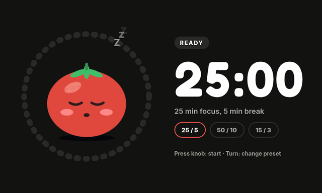

# my-thing

<a href="https://0rwx.com/" title="0rwx AI:W: AI collaboration (AI has read-write access; I read the code)">
  <picture>
    <source media="(prefers-color-scheme: dark)" srcset="docs/AI-W-dark.svg">
    
  </picture>
</a>

Productivity app for the Spotify Car Thing.

## Pomodoro



Presets: 25/5, 50/10, 15/3 (focus/break minutes).

| State | Knob press | Knob turn | Back (Esc) | Timer reaches 0 |
|---|---|---|---|---|
| **Ready** | start Focus at the preset's focus length | cycle presets (wraps) | nothing | n/a |
| **Focus** | pause / resume | ±1 min per detent, clamped to 1–99 min (also while paused) | → Ready | → FocusDone |
| **FocusDone** (alarm) | start Break at the preset's break length | Focus for 5 more minutes | → Ready | n/a |
| **Break** | skip → Ready | ±1 min, same clamp | → Ready | → BreakDone |
| **BreakDone** (alarm) | start Focus | Break for 5 more minutes | → Ready | n/a |

On the desktop: ←/→ = knob turn, Enter = knob press, Esc = back. To reach an alarm quickly, turn down to 1:00 in Focus or Break.

## Desktop

```sh
cargo run
```

## Device

The device runs our own Yocto image (`my-thing-image`, layer `yocto/meta-my-thing`, see `../plans/2-permanent-deploy.md`). my-thing starts at boot as the `my-thing` systemd service on top of Weston, and restarts if it crashes. The device is `my-thing.local` (or `DEVICE=10.42.1.74` if mDNS doesn't resolve).

One-time setup: the Rust target and the SDK (see [SDK](#sdk) below):

```sh
rustup target add aarch64-unknown-linux-gnu
```

**Try a build** (temporary): build, copy to the device and run it in the foreground in place of the service (Ctrl-C to quit; the installed app comes back):

```sh
cargo device-run
```

**Install a build** (permanent, no reflash): build, strip, copy to `/opt/my-thing/bin/my-thing.current` and restart the service. The old binary is kept as `my-thing.previous`:

```sh
scripts/device-install.sh
scripts/device-install.sh --rollback    # swap back (run again to undo)
```

`/opt/my-thing` is the bandaid partition, so an installed build survives reboots. A full reflash resets it to the binary baked into the image.

**Rebuild the image** (from `yocto/`; it builds my-thing from this working tree):

```sh
just build                     # kas-container build, with build/ and sources/ in yocto/
just flash                     # hold buttons 1+4 while plugging in USB
just boot-kernel               # if it stays in mask-rom
just ssh                       # root@my-thing.local
```

Notes:
- `cargo device-build` only builds: `target/aarch64-unknown-linux-gnu/release/my-thing`
- `SLINT_DEBUG_PERFORMANCE=refresh_lazy,overlay cargo device-run` shows FPS
- Logs: `just ssh journalctl -u my-thing -f` (from `yocto/`)
- Weston rotates the portrait panel, so Slint renders unrotated on the GPU (femtovg) with crisp text. Rendering straight to the display with `SLINT_KMS_ROTATION` made femtovg draw text as outlines (bold), and the software renderer was too slow (~12 fps on some screens).

## SDK

`cargo device-build` / `device-run` / `scripts/device-install.sh` cross-compile with a Yocto SDK: a toolchain plus a sysroot with the device's libraries. `.cargo/config.toml` and `scripts/sdk-cc.sh` find it through the `sdk` symlink in this directory (gitignored).

Build the SDK from our own image, so its sysroot matches what's on the device. Rebuild it whenever the image's libraries change.

1. Generate it (from `yocto/`; uses `yocto/kas/sdk.yml`, which keeps it small with `SDKIMAGE_FEATURES = "dev-pkgs"`):
   ```sh
   just sdk
   ```
   Output: `yocto/build/tmp/deploy/sdk/my-thing-distro-glibc-x86_64-my-thing-image-cortexa53-superbird-toolchain-0.1.0.sh` (~240 MB).
2. Install it somewhere that doesn't need sudo (replacing an older install):
   ```sh
   rm -rf ~/.local/my-thing-sdk
   yocto/build/tmp/deploy/sdk/my-thing-distro-glibc-x86_64-my-thing-image-cortexa53-superbird-toolchain-0.1.0.sh -d ~/.local/my-thing-sdk -y
   ```
3. Link it here:
   ```sh
   ln -sfn ~/.local/my-thing-sdk sdk
   ```
4. After switching SDKs, clean the device build so nothing compiled against the old sysroot is reused, then build:
   ```sh
   cargo clean --release --target aarch64-unknown-linux-gnu
   cargo device-build
   ```

`scripts/sdk-cc.sh` also honours `SUPERBIRD_SDK=/path/to/sdk` instead of the symlink.
