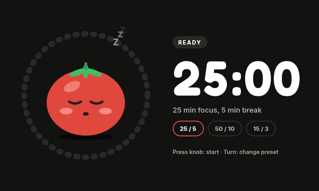

# my-thing

<a href="https://0rwx.com/" title="0rwx AI:W: AI collaboration (AI has read-write access; I read the code)">
  <picture>
    <source media="(prefers-color-scheme: dark)" srcset="docs/AI-W-dark.svg">
    
  </picture>
</a>

Productivity app for the Spotify Car Thing.

## Pages

The preset buttons switch apps: **1 = Calendar** (shown at startup), **2 = Pomodoro**. 3 and 4 are unused.

The knob, Enter and Back only reach the page that's showing. Hidden apps keep running, so a Pomodoro timer keeps counting down while the Calendar is on screen.

## Calendar

Shows your Google Calendar as a station departure board (design "A · Departures list"): a black header with the date, the badge legend, the number of all-day events and the clock. Below it, the event in progress as a yellow NOW row (time range, minutes left, and a bar showing how much is over), then the next departures, each with its start time, location and a big countdown ("23 MIN", "1:08 HR").

Each event gets a lettered badge, like a train line. First match wins:

| Badge | Rule |
|---|---|
| **F** (purple) | focus time (Google's "Focus time" event type) |
| **T** (orange) | you booked it: you're the organizer, including events you made yourself |
| **W** (blue) | an invitation you haven't accepted (needs action or "maybe"). Declined ones are hidden |
| **P** (green) | everything else (accepted invitations, events on shared calendars) |

The header shows a legend of the badges present.

Office rooms at 285W 5th are shortened to just the room: `285W 5th-4FL-Room 306 (6)` → `Room 306`, `285W 5th-3FL-Main Conference Room (311) (12)` → `Main Conference Room (311)`. Everything up to the floor marker (`4FL-`, `3FL-`, …) goes, and so does the occupancy in the last brackets. Other locations are shown as they are. Sync problems show in yellow in the header ("Sync failed (last synced 12:03): …"). Before the first sync, the page shows the login state instead.

| Input | Calendar page |
|---|---|
| Knob turn | scroll the departures under the NOW row |
| Knob press | sync now (it also syncs every 5 minutes by itself) |
| Back (Esc) | back to the next event |

It stays on the event you scrolled to through syncs and as events start (if that event goes away, it moves to the next one after it). It goes back to the next event when you press Back, switch to the page, or after 2 minutes without turning the knob.

- Fetches every calendar ticked in Google Calendar, from the start of today to 14 days ahead. Google expands recurring events. Declined events, cancelled events and Workspace "working location" markers are hidden.
- Re-fetches every 5 minutes. After an error it retries sooner (30 s, doubling) and keeps showing the last events. The terminal lists the next few events whenever they change.
- `cargo run -- --demo` skips Google and shows made-up events, for working on the layout without a login.

### Google login

Reads your Google Calendar through the Calendar API with read-only access (`calendar.readonly`).

One-time setup in [Google Cloud console](https://console.cloud.google.com/), signed in with the calendar's account:

1. Create a project (or pick one).
2. **APIs & Services → Library**: enable **Google Calendar API**.
3. **Google Auth Platform → Branding / Audience**: user type **Internal** (Workspace accounts: no "unverified app" warning, and logins don't expire after 7 days). Fill in the app name and emails.
4. **Google Auth Platform → Clients → Create client**: type **Desktop app**. Download the JSON and save it as `~/.config/my-thing/google-client.json`. Keep it out of the repo.

Then `cargo run`. The first time, the terminal prints a login link: open it in a browser **on the same computer** and approve. The browser is sent back to `http://127.0.0.1:<port>`, where the app is listening. The login is saved to `~/.local/state/my-thing/google-login.json` (owner-only), so later runs go straight to "Logged in as …".

- `cargo run -- --logout` revokes the saved login, deletes it, and starts a fresh login.
- If the login is revoked (Google account → Security → Third-party connections) or expires, the app deletes it and prints a new link. Network errors keep the login and retry every 30 s.
- If your Workspace admin blocks unverified third-party apps, they need to allow this client ID (Admin console → Security → API controls).

#### On the device

The device has no browser, so log in on the desktop and copy both files over. A refresh token isn't tied to the machine it was made on, and with an Internal app it doesn't expire. The service runs with `HOME=/var/lib/my-thing` (on the writable settings partition), so the files go under that directory:

```sh
cargo run                      # once, on the desktop: log in until it says "Logged in as …", then quit
ssh root@my-thing.local 'mkdir -p /var/lib/my-thing/.config/my-thing /var/lib/my-thing/.local/state/my-thing'
scp ~/.config/my-thing/google-client.json root@my-thing.local:/var/lib/my-thing/.config/my-thing/
scp ~/.local/state/my-thing/google-login.json root@my-thing.local:/var/lib/my-thing/.local/state/my-thing/
ssh root@my-thing.local 'chmod 600 /var/lib/my-thing/.local/state/my-thing/google-login.json && systemctl restart my-thing'
```

- The device rewrites `google-login.json` whenever it refreshes the access token, which is why it has to be on a writable partition.
- Desktop and device each use their own copy of the same login. Logging out on one (`--logout` revokes it with Google) logs out both; copy a fresh login after logging in again.
- If the device shows "Google login expired or was revoked", it's waiting for a login it can't do: log in on the desktop and copy `google-login.json` again.
- The device needs a roughly correct clock: HTTPS certificates and token expiry depend on it.

## Pomodoro



Presets: 25/5, 50/10, 15/3 (focus/break minutes).

| State | Knob press | Knob turn | Back (Esc) | Timer reaches 0 |
|---|---|---|---|---|
| **Ready** | start Focus at the preset's focus length | cycle presets (wraps) | nothing | n/a |
| **Focus** | pause / resume | ±1 min per detent, clamped to 1–99 min (also while paused) | → Ready | → FocusDone |
| **FocusDone** (alarm) | start Break at the preset's break length | Focus for 5 more minutes | → Ready | n/a |
| **Break** | skip → Ready | ±1 min, same clamp | → Ready | → BreakDone |
| **BreakDone** (alarm) | start Focus | Break for 5 more minutes | → Ready | n/a |

On the desktop: ←/→ = knob turn, Enter = knob press, Esc = back, 1–4 = preset buttons. To reach an alarm quickly, turn down to 1:00 in Focus or Break.

On Ready (and on the Calendar), the backlight dims after 20 s without input. Any input brightens it again and also does its normal action (e.g. a turn still changes the preset).

## Desktop

```sh
cargo run
```

## Device

The device runs our own Yocto image (`my-thing-image`, layer `yocto/meta-my-thing`, see `../plans/2-permanent-deploy.md`). my-thing starts at boot as the `my-thing` systemd service on top of Weston, and restarts if it crashes. The device is `my-thing.local` (or `DEVICE=10.42.1.74` if mDNS doesn't resolve).

One-time setup: the Rust target and the SDK (see [SDK](#sdk) below):

```sh
rustup target add aarch64-unknown-linux-gnu
```

**Try a build** (temporary): build, copy to the device and run it in the foreground in place of the service (Ctrl-C to quit; the installed app comes back):

```sh
cargo device-run
```

**Install a build** (permanent, no reflash): build, strip, copy to `/opt/my-thing/bin/my-thing.current` and restart the service. The old binary is kept as `my-thing.previous`:

```sh
scripts/device-install.sh
scripts/device-install.sh --rollback    # swap back (run again to undo)
```

`/opt/my-thing` is the bandaid partition, so an installed build survives reboots. A full reflash resets it to the binary baked into the image.

**Rebuild the image** (from `yocto/`; it builds my-thing from this working tree):

```sh
just build                     # kas-container build, with build/ and sources/ in yocto/
just flash                     # hold buttons 1+4 while plugging in USB
just boot-kernel               # if it stays in mask-rom
just ssh                       # root@my-thing.local
```

Notes:
- `cargo device-build` only builds: `target/aarch64-unknown-linux-gnu/release/my-thing`
- `SLINT_DEBUG_PERFORMANCE=refresh_lazy,overlay cargo device-run` shows FPS
- Logs: `just ssh journalctl -u my-thing -f` (from `yocto/`)
- Weston rotates the portrait panel, so Slint renders unrotated on the GPU (femtovg) with crisp text. Rendering straight to the display with `SLINT_KMS_ROTATION` made femtovg draw text as outlines (bold), and the software renderer was too slow (~12 fps on some screens).

## SDK

`cargo device-build` / `device-run` / `scripts/device-install.sh` cross-compile with a Yocto SDK: a toolchain plus a sysroot with the device's libraries. `.cargo/config.toml` and `scripts/sdk-cc.sh` find it through the `sdk` symlink in this directory (gitignored).

Build the SDK from our own image, so its sysroot matches what's on the device. Rebuild it whenever the image's libraries change.

1. Generate it (from `yocto/`; uses `yocto/kas/sdk.yml`, which keeps it small with `SDKIMAGE_FEATURES = "dev-pkgs"`):
   ```sh
   just sdk
   ```
   Output: `yocto/build/tmp/deploy/sdk/my-thing-distro-glibc-x86_64-my-thing-image-cortexa53-superbird-toolchain-0.1.0.sh` (~240 MB).
2. Install it somewhere that doesn't need sudo (replacing an older install):
   ```sh
   rm -rf ~/.local/my-thing-sdk
   yocto/build/tmp/deploy/sdk/my-thing-distro-glibc-x86_64-my-thing-image-cortexa53-superbird-toolchain-0.1.0.sh -d ~/.local/my-thing-sdk -y
   ```
3. Link it here:
   ```sh
   ln -sfn ~/.local/my-thing-sdk sdk
   ```
4. After switching SDKs, clean the device build so nothing compiled against the old sysroot is reused, then build:
   ```sh
   cargo clean --release --target aarch64-unknown-linux-gnu
   cargo device-build
   ```

`scripts/sdk-cc.sh` also honours `SUPERBIRD_SDK=/path/to/sdk` instead of the symlink.
